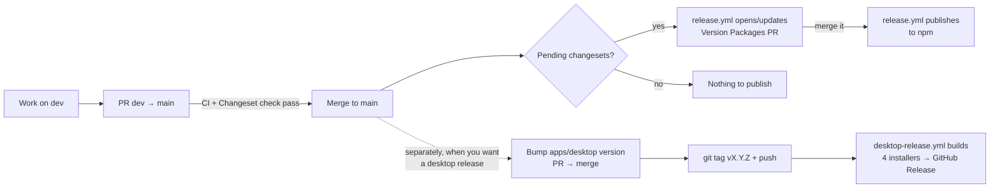

# Pushing and releasing

How a change gets from your machine to `main`, and how each thing this repo ships gets published.

## What gets released, and how

| What | Where it goes | Triggered by | Workflow |
|---|---|---|---|
| `@tracethrough/core` | npm | Merging the **Version Packages** PR into `main` | [release.yml](../.github/workflows/release.yml) |
| `@tracethrough/node` | npm | Same | Same |
| `@tracethrough/next` | npm | Same | Same |
| Desktop app (Windows, macOS, Linux installers) | GitHub Releases | Pushing a `v*` tag | [desktop-release.yml](../.github/workflows/desktop-release.yml) |

These packages are **private and never published**: `@tracethrough/desktop` (shipped as installers, not to npm), `@tracethrough/capture`, `@tracethrough/collector`, `@tracethrough/fixtures`, and the two examples. Changesets ignores them ([.changeset/config.json](../.changeset/config.json)).

The npm packages and the desktop app are versioned separately. Releasing one does not release the other.



---

## 1. Everyday flow: pushing a change

1. Work on `dev` (or a feature branch off it) and commit.
2. **If you changed `packages/core`, `packages/node` or `packages/next`**, add a changeset:

   ```bash
   pnpm changeset
   ```

   Pick the packages, the bump (`patch` / `minor` / `major`) and write a one-line summary. It creates a file in `.changeset/`; commit it with your change.

   If the change needs no npm release (tests, docs, internal refactor), add an empty changeset instead:

   ```bash
   pnpm changeset --empty
   ```

   Changes only to the desktop app, examples or private packages need no changeset.

3. Check locally before pushing:

   ```bash
   pnpm typecheck
   ```

   ```bash
   pnpm test
   ```

4. Push and open a PR from `dev` into `main`.
5. On the PR these checks run:
   - **CI** ([ci.yml](../.github/workflows/ci.yml)): typecheck, unit tests and desktop end-to-end tests on Windows, macOS and Linux, a packaged-Windows-app test, and a Next.js App Connect test. It runs on every PR, not on pushes.
   - **Changeset** ([changeset-check.yml](../.github/workflows/changeset-check.yml)): PRs into `main` only. Fails if a published package changed without a changeset. Skipped for Dependabot and for the Version Packages PR.
6. Merge when green. Merging to `main` starts `release.yml` (section 2).

---

## 2. Publishing the npm packages

Releases go through [Changesets](https://github.com/changesets/changesets). You never run `npm publish` yourself.

### Steps

1. **Merge PRs that contain changesets into `main`** (section 1).
2. **`release.yml` opens a PR called "Version Packages"** on the `changeset-release/main` branch. It:
   - bumps `version` in each affected `package.json`,
   - writes each package's `CHANGELOG.md`,
   - deletes the consumed `.changeset/*.md` files.

   Each new merge with more changesets updates the same PR. Let changes pile up until you're ready to release.
3. **Review and merge the Version Packages PR.**
4. **`release.yml` runs again**, finds no pending changesets, and runs `pnpm release`, which:
   - builds the three packages (`pnpm build:packages` → `tsc` into each `dist/`),
   - runs `changeset publish`, which publishes every package whose new version isn't on npm yet, with provenance. `publishConfig` points `exports` at `dist/`, and only `dist`, `LICENSE` and `README.md` are included.

   It does **not** create GitHub Releases for npm packages (`create-github-releases: false`), so the repo's "latest release" stays the desktop installers.
5. **Check it published:**

   ```bash
   npm view @tracethrough/core version
   ```

   ```bash
   npm view @tracethrough/node version
   ```

   ```bash
   npm view @tracethrough/next version
   ```

### How versions move together

- The three packages are **linked**. When more than one of them is released together, they all get the highest version among them. A package with no changeset and no changed dependency is not bumped.
- `@tracethrough/next` depends on `@tracethrough/node`, which depends on `@tracethrough/core`. If you bump `core`, Changesets bumps its dependents by at least a patch (`updateInternalDependencies: "patch"`), so users always get a matching set. `workspace:*` is replaced with the real version on publish.

### Version Packages PR stuck on "checks pending"

PRs opened with the default `GITHUB_TOKEN` don't trigger CI. Either:

- add a `RELEASE_TOKEN` secret (fine-grained PAT, Contents + Pull requests: read/write), or
- close and reopen the Version Packages PR to start CI by hand.

### One-time setup (status)

All three packages are on npm at `0.1.0`, so the first publish is done. Remaining items:

- [ ] On npmjs.com, enable **trusted publishing** for each package (repository `solomonade1/trace-lens`, workflow `release.yml`).
- [ ] Then delete the `NPM_TOKEN` repository secret and the `NODE_AUTH_TOKEN` line in `release.yml`.
- [ ] Settings → Actions → General: "Allow GitHub Actions to create and approve pull requests" must stay on.
- [ ] Optional: add `RELEASE_TOKEN` (see above).

---

## 3. Publishing the desktop app (Windows, macOS, Linux)

### Test the builds first (no release)

Actions tab → **Desktop release** → **Run workflow** on `main`. It builds all four installers and uploads them as workflow artifacts you can download and try. Nothing is published.

### Release

1. **Bump the version** in [apps/desktop/package.json](../apps/desktop/package.json) (for example `0.1.0` → `0.2.0`). Commit it on `dev`, PR into `main`, merge. Changesets ignores the desktop app, so this is always manual. Skip this step for the very first release; the version is already `0.1.0`.
2. **Tag the merged commit on `main` and push the tag:**

   ```bash
   git fetch origin
   ```

   ```bash
   git tag v0.2.0 origin/main
   ```

   ```bash
   git push origin v0.2.0
   ```

   The tag must be `v` + the exact version in `apps/desktop/package.json`, or every build fails at "Check tag matches the app version".
3. **`desktop-release.yml` builds four installers in parallel:**

   | Platform | Runner | File |
   |---|---|---|
   | Windows x64 | `windows-latest` | `TraceThrough-Setup-<version>-x64.exe` |
   | macOS Apple Silicon | `macos-latest` | `TraceThrough-<version>-mac-arm64.dmg` |
   | macOS Intel | `macos-15-intel` | `TraceThrough-<version>-mac-x64.dmg` |
   | Linux x64 | `ubuntu-latest` | `TraceThrough-<version>-linux-<arch>.AppImage` |

4. **The release job** collects them, writes `SHA256SUMS.txt`, and creates the GitHub Release "TraceThrough vX.Y.Z" with auto-generated notes. The release job only runs if all four builds succeed.
5. **Check it:** the repo's Releases page should list five files (four installers and `SHA256SUMS.txt`). The README's Install section links to `releases/latest`.

### If a desktop release fails

- **A build failed:** fix it on `dev` → PR → merge. Then move the tag to the fixed commit:

  ```bash
  git push origin :refs/tags/v0.2.0
  ```

  ```bash
  git tag -f v0.2.0 origin/main
  ```

  ```bash
  git push origin v0.2.0
  ```

- **The release exists but is wrong:** delete the release on GitHub first, then move the tag as above.

### Not set up yet

- **Code signing / notarization.** Installers are unsigned (`CSC_IDENTITY_AUTO_DISCOVERY: false`), so Windows SmartScreen and macOS Gatekeeper warn users. The README's "Unsigned builds" section tells them how to get past it.
- **Auto-update.** Users download new versions by hand.

---

## 4. Dependabot

[dependabot.yml](../.github/dependabot.yml) opens monthly PRs into `main`: one grouped PR for npm minor/patch updates and one for GitHub Actions. CI runs on them; the changeset check is skipped. If a dependency update changes what users of `core`/`node`/`next` install, add a changeset to that PR (or a follow-up) so a new version gets published.

Dependabot can also run right after a merge to `main` that changes a manifest. Its pnpm only accepts package versions at least 3 days old. If `pnpm-lock.yaml` pins anything newer, the run fails with `ERR_PNPM_NO_MATCHING_VERSION ... was released at ...`. Wait until the newest pinned version is 3 days old and re-run (Insights → Dependency graph → Dependabot → Check for updates).

---

## Quick reference

| I want to… | Do this |
|---|---|
| Ship a code change | PR `dev` → `main`, with `pnpm changeset` if core/node/next changed |
| Release to npm | Merge the **Version Packages** PR |
| See what's queued for npm | `pnpm changeset status`, or open the Version Packages PR |
| Release the desktop app | Bump `apps/desktop` version → merge → `git tag vX.Y.Z origin/main` → `git push origin vX.Y.Z` |
| Test installers without releasing | Actions → Desktop release → Run workflow |
| Build an installer locally | `pnpm package:win` / `pnpm package:mac` / `pnpm package:linux` (output in `apps/desktop/release/`) |
