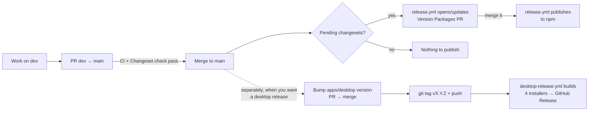

# Pushing and releasing

How a change gets from your machine to `main`, and how each thing this repo ships gets published.

## What gets released, and how

| What | Where it goes | Triggered by | Workflow |
|---|---|---|---|
| `@tracethrough/core` | npm | Merging the **Version Packages** PR into `main` | [release.yml](../.github/workflows/release.yml) |
| `@tracethrough/node` | npm | Same | Same |
| `@tracethrough/next` | npm | Same | Same |
| Desktop app (Windows, macOS, Linux installers) | GitHub Releases | Pushing a `v*` tag | [desktop-release.yml](../.github/workflows/desktop-release.yml) |

These packages are **private and never published**: `@tracethrough/desktop` (shipped as installers, not to npm), `@tracethrough/capture`, `@tracethrough/collector`, `@tracethrough/fixtures`, and the two examples. Changesets ignores them ([.changeset/config.json](../.changeset/config.json)).

The npm packages and the desktop app are versioned separately. Releasing one does not release the other.



---

## 1. Everyday flow: pushing a change

1. Work on `dev` (or a feature branch off it) and commit.
2. **If you changed `packages/core`, `packages/node` or `packages/next`**, add a changeset:

   ```bash
   pnpm changeset
   ```

   Pick the packages, the bump (`patch` / `minor` / `major`) and write a one-line summary. It creates a file in `.changeset/`; commit it with your change.

   If the change needs no npm release (tests, docs, internal refactor), add an empty changeset instead:

   ```bash
   pnpm changeset --empty
   ```

   Changes only to the desktop app, examples or private packages need no changeset.

3. Check locally before pushing:

   ```bash
   pnpm typecheck
   ```

   ```bash
   pnpm test
   ```

4. Push and open a PR from `dev` into `main`.
5. On the PR these checks run:
   - **CI** ([ci.yml](../.github/workflows/ci.yml)): typecheck, unit tests and desktop end-to-end tests on Windows, macOS and Linux, the packed-package smoke test (Linux leg), a packaged-Windows-app test, a Next.js App Connect test, and the Next.js 15/16 dev and start matrix. It runs on every PR, not on pushes.
   - **Changeset** ([changeset-check.yml](../.github/workflows/changeset-check.yml)): PRs into `main` only. Fails if a published package changed without a changeset. Skipped for Dependabot and for the Version Packages PR.
6. Merge when green. Merging to `main` starts `release.yml` (section 2).

---

## 2. Publishing the npm packages

Releases go through [Changesets](https://github.com/changesets/changesets). You never run `npm publish` yourself.

### Steps

1. **Merge PRs that contain changesets into `main`** (section 1).
2. **`release.yml` opens a PR called "Version Packages"** on the `changeset-release/main` branch. It:
   - bumps `version` in each affected `package.json`,
   - writes each package's `CHANGELOG.md`,
   - deletes the consumed `.changeset/*.md` files.

   Each new merge with more changesets updates the same PR. Let changes pile up until you're ready to release.
3. **Review and merge the Version Packages PR.**
4. **`release.yml` runs again.** First its `validate` job ([validate.yml](../.github/workflows/validate.yml)) re-runs typecheck, tests and `pnpm smoke:packages` on that exact commit; if it fails nothing is versioned or published. Then the release job finds no pending changesets and runs `pnpm release`, which:
   - builds the three packages (`pnpm build:packages` → `tsc` into each `dist/`),
   - runs `changeset publish`, which publishes every package whose new version isn't on npm yet, with provenance. `publishConfig` points `exports` at `dist/`, and only `dist`, `LICENSE` and `README.md` are included.

   It does **not** create GitHub Releases for npm packages (`create-github-releases: false`), so the repo's "latest release" stays the desktop installers.
5. **Check it published:**

   ```bash
   npm view @tracethrough/core version
   ```

   ```bash
   npm view @tracethrough/node version
   ```

   ```bash
   npm view @tracethrough/next version
   ```

### How versions move together

- The three packages are **linked**. When more than one of them is released together, they all get the highest version among them. A package with no changeset and no changed dependency is not bumped.
- `@tracethrough/next` depends on `@tracethrough/node`, which depends on `@tracethrough/core`. If you bump `core`, Changesets bumps its dependents by at least a patch (`updateInternalDependencies: "patch"`), so users always get a matching set. `workspace:*` is replaced with the real version on publish.

### Version Packages PR stuck on "checks pending"

PRs opened with the default `GITHUB_TOKEN` don't trigger CI. Either:

- add a `RELEASE_TOKEN` secret (fine-grained PAT, Contents + Pull requests: read/write), or
- close and reopen the Version Packages PR to start CI by hand.

### Pack check (no publishing)

`pnpm smoke:packages` is what `validate` runs. It builds `core`, `node` and `next`, packs them exactly as publishing does (`pnpm pack`, which applies `publishConfig`), checks the tarball contents and manifests (no `workspace:` ranges, only `dist`, `LICENSE` and `README.md`), installs the three tarballs with npm into a throwaway project outside the workspace, and checks that imports resolve to the shipped JavaScript, that the types resolve, and that the SDK registers, reports to a test collector and shuts down. It never publishes. Run it locally before a release if you changed packaging.

### One-time setup (status)

All three packages are on npm at `0.2.0` (checked with `npm view` on 5 Nov 2026), so the first publishes are done. Remaining items:

- [ ] On npmjs.com, enable **trusted publishing** for each package (repository `solomonade1/tracethrough`, workflow `release.yml`).
- [ ] Then delete the `NPM_TOKEN` repository secret and the `NODE_AUTH_TOKEN` line in `release.yml`.
- [ ] Settings → Actions → General: "Allow GitHub Actions to create and approve pull requests" must stay on.
- [ ] Optional: add `RELEASE_TOKEN` (see above).

---

## 3. Publishing the desktop app (Windows, macOS, Linux)

### Test the builds first (no release)

Actions tab → **Desktop release** → **Run workflow** on `main`. It builds all four installers and uploads them as workflow artifacts you can download and try. Nothing is published.

### Release

1. **Bump the version** in [apps/desktop/package.json](../apps/desktop/package.json) (for example `0.2.0` → `0.3.0`). Commit it on `dev`, PR into `main`, merge. Changesets ignores the desktop app, so this is always manual.
2. **Tag the merged commit on `main` and push the tag:**

   ```bash
   git fetch origin
   ```

   ```bash
   git tag vX.Y.Z origin/main
   ```

   ```bash
   git push origin vX.Y.Z
   ```

   The tag must be `v` + the exact version in `apps/desktop/package.json`, and must point at a commit on `main`. The **guard** job ([scripts/check-desktop-release.mjs](../scripts/check-desktop-release.mjs)) fails the run before anything is built otherwise, so a tag cannot ship code that never went through the protected branch.
3. **`desktop-release.yml` runs in stages, each gating the next:** guard → **validate** (the full [ci.yml](../.github/workflows/ci.yml) matrix on the tagged commit) → **build** → **smoke** → **release**. The build stage makes four installers in parallel:

   | Platform | Runner | File |
   |---|---|---|
   | Windows x64 | `windows-latest` | `TraceThrough-Setup-<version>-x64.exe` |
   | macOS Apple Silicon | `macos-latest` | `TraceThrough-<version>-mac-arm64.dmg` |
   | macOS Intel | `macos-15-intel` | `TraceThrough-<version>-mac-x64.dmg` |
   | Linux x64 | `ubuntu-latest` | `TraceThrough-<version>-linux-<arch>.AppImage` |

4. **Signing is verified, not assumed.** After packaging, [scripts/verify-signing.mjs](../scripts/verify-signing.mjs) reads the signature off each finished installer (Authenticode on Windows; `codesign`, Gatekeeper and the stapled notarization ticket on the mounted macOS dmg). If signing credentials were configured for that platform the build fails unless the installer verifies as signed (and notarized, when Apple credentials exist); if they were not, it records the installer as unsigned.
5. **Smoke:** every installer is installed on its own OS (Windows: silent NSIS install; macOS: copy the app out of the dmg; Linux: unpack the AppImage, as runners lack FUSE) and [installed.e2e.test.ts](../apps/desktop/test/installed.e2e.test.ts) runs against the installed app: window opens, environment detection reports the right version and a browser, a fixture capture completes, and with `TRACETHROUGH_TEST_NO_BROWSERS=1` the app shows its "needs Chrome or Edge" message without blocking the rest of the UI.
6. **The release job** only runs if every build and smoke job succeeded. It writes `SHA256SUMS.txt` and creates the GitHub Release "TraceThrough vX.Y.Z" with auto-generated notes preceded by a signing table taken from step 4, which says "not code-signed" whenever any Windows or macOS installer is unsigned.
7. **Check it:** the repo's Releases page should list five files (four installers and `SHA256SUMS.txt`) and the signing table should match what you intended. The README's Install section links to `releases/latest`.

### If a desktop release fails

- **A build failed:** fix it on `dev` → PR → merge. Then move the tag to the fixed commit:

  ```bash
  git push origin :refs/tags/vX.Y.Z
  ```

  ```bash
  git tag -f vX.Y.Z origin/main
  ```

  ```bash
  git push origin vX.Y.Z
  ```

- **The release exists but is wrong:** delete the release on GitHub first, then move the tag as above.

### Code signing and notarization (optional, off until secrets exist)

The pipeline signs when it finds credentials and otherwise produces explicitly unsigned installers, exactly as before. Add these as **repository secrets** (Settings → Secrets and variables → Actions); the workflow gives each platform only its own:

| Secret | Used for |
|---|---|
| `WIN_CSC_LINK`, `WIN_CSC_KEY_PASSWORD` | Windows code-signing certificate (`.pfx`, as a base64 string or URL electron-builder accepts) and its password |
| `MAC_CSC_LINK`, `MAC_CSC_KEY_PASSWORD` | macOS "Developer ID Application" certificate (`.p12`) and its password |
| `APPLE_ID`, `APPLE_APP_SPECIFIC_PASSWORD`, `APPLE_TEAM_ID` | macOS notarization (requires the macOS secrets above; without them the dmg is signed but not notarized) |

Credentials are read from the environment by electron-builder only; nothing is written to the repository, the config or the installer. Which steps run is decided in [apps/desktop/signing.cjs](../apps/desktop/signing.cjs) (unit-tested without credentials). Not supported yet: Azure Trusted Signing / cloud HSM certificates for Windows, and Apple API-key notarization from the workflow (the config accepts it, the workflow does not pass those secrets).

**Status: signing has not been exercised.** No certificates were available while this was built, so the signed path is untested: the credential-less path (unsigned, labelled as such) and the verifier's parsing are tested, the signed Windows and macOS paths are not. Run the **Desktop release** workflow by hand once after adding secrets and read the signing table in the job logs before tagging a real release; the build fails on a configured-but-unverifiable signature by design.

### Not set up yet

- **Auto-update.** Users download new versions by hand.

### Repository settings to check by hand

These live in GitHub settings, not in the repository, and could not be inspected from the repository checkout (the GitHub CLI was not available while this was written). Treat each as unverified until someone with admin rights has looked:

- **Required status checks** on `main`. [.github/rulesets/protect-main.json](../.github/rulesets/protect-main.json) lists `Test (windows-latest)`, `Test (macos-latest)`, `Test (ubuntu-latest)`, `App Connect with Next.js (ubuntu-latest)` and `Changeset`. Confirm the live ruleset matches it, and decide whether to add `Next.js matrix (ubuntu-latest)` (slow, so deliberately not required yet).
- **Tag protection** for `v*`: only maintainers should be able to create or move release tags. The guard job checks the tag's commit is on `main`, but cannot stop someone else pushing a tag.
- **Secrets**: whether `NPM_TOKEN`, `RELEASE_TOKEN` and the signing secrets above exist, and that "Allow GitHub Actions to create and approve pull requests" is on.
- **npm trusted publishing** for each package (section 2) and, if used, an environment with required reviewers for the publish step.

---

## 4. Dependabot

[dependabot.yml](../.github/dependabot.yml) opens monthly PRs into `main`: one grouped PR for npm minor/patch updates and one for GitHub Actions. CI runs on them; the changeset check is skipped. If a dependency update changes what users of `core`/`node`/`next` install, add a changeset to that PR (or a follow-up) so a new version gets published.

Dependabot can also run right after a merge to `main` that changes a manifest. Its pnpm only accepts package versions at least 3 days old. If `pnpm-lock.yaml` pins anything newer, the run fails with `ERR_PNPM_NO_MATCHING_VERSION ... was released at ...`. Wait until the newest pinned version is 3 days old and re-run (Insights → Dependency graph → Dependabot → Check for updates).

---

## Quick reference

| I want to… | Do this |
|---|---|
| Ship a code change | PR `dev` → `main`, with `pnpm changeset` if core/node/next changed |
| Release to npm | Merge the **Version Packages** PR |
| See what's queued for npm | `pnpm changeset status`, or open the Version Packages PR |
| Release the desktop app | Bump `apps/desktop` version → merge → `git tag vX.Y.Z origin/main` → `git push origin vX.Y.Z` |
| Check the npm tarballs without publishing | `pnpm smoke:packages` |
| Check an installed copy of the app | `TRACETHROUGH_E2E_EXECUTABLE=<path to the executable> pnpm exec vitest run --config apps/desktop/vitest.config.ts installed` |
| Test installers without releasing | Actions → Desktop release → Run workflow |
| Build an installer locally | `pnpm package:win` / `pnpm package:mac` / `pnpm package:linux` (output in `apps/desktop/release/`) |
